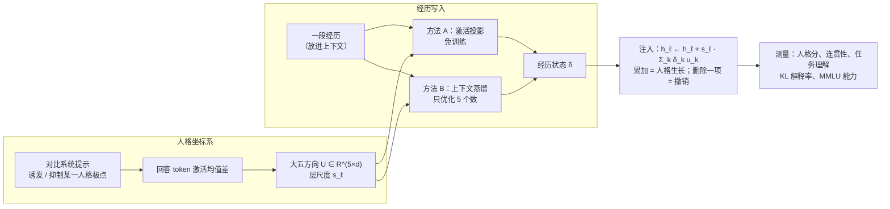

<div align="center">

# 鹿角记忆 · Antler Memory

**经历能否写成大模型的人格状态？基于残差流激活注入的实证研究**

*Can experiences be written into an LLM's persona? An empirical study with residual-stream activation states*

[](requirements.txt)
[](requirements.txt)
[](https://huggingface.co/Qwen/Qwen3-4B-Instruct-2507)
[](tests/)
[](LICENSE)

王凌松 · 华东师范大学 软件工程 · [17721556010@163.com](mailto:17721556010@163.com)

</div>

---

## 摘要

让大模型拥有稳定、可演化的人格，常见做法是写系统提示或微调权重：前者容易被上下文冲淡，后者代价高，而且无法撤销。近期工作发现，大五人格特质在残差流中对应近似线性的方向，可以在推理时注入。本研究进一步追问：**一段经历对模型的影响，能否压缩成残差流中的一个低维状态，并以人格方向读出？**

我们在冻结权重的 Qwen3-4B-Instruct-2507 上建立了完整的实验框架：用对比提示提取大五方向，构建人格坐标系；用免训练的激活投影和只优化 5 个参数的上下文蒸馏两种方法，把经历写成状态向量；提出"人格解释率"指标，衡量经历影响中有多大比例落在人格子空间内；并设计"双胞胎经历"范式（同一情境、同一行动、结局相反），区分模型保存的是具体经历还是笼统的情绪。

主要结果如下：

1. 单层线性注入能单调调节人格，但伴随维度间串扰和明显的质量代价；同等条件下，温和的系统提示质量代价更小。
2. 大五子空间平均解释经历效应的 11.40%，约为同维度随机子空间（2.35%）的 5 倍，但远低于不受约束的全维状态（36.34%）。
3. 结局对后续人格表现的影响依赖具体情境，6 个情境中只有 1 个稳定成立。
4. 在内部表示上，"好结局减坏结局"的激活差在两种相反行动下几乎同向（余弦 0.968），区分具体行动的分量在人格子空间中只保留 0.55% 的能量。

这些结果表明：**大模型主要把经历编码为一个共同的"好/坏"效价信号，而不是与具体事件相关的人格更新。** 这为"大模型人格变化只有均值、没有形状"的已知行为现象提供了一个机制层面的解释。

**English abstract.** We study whether the effect of an experience on a frozen LLM (Qwen3-4B-Instruct-2507) can be compressed into a low-dimensional residual-stream state that is read out along Big-Five persona directions. We build a persona coordinate system by contrastive activation steering, write experiences as state vectors via training-free projection and 5-parameter context distillation, introduce a *persona explained ratio*, and design a *twin-experience* paradigm (same situation and action, opposite outcome). Single-layer steering moves persona scores monotonically but incurs crosstalk and quality costs. The Big-Five subspace explains 11.40% of an experience's distributional effect, about five times a random 5-D subspace (2.35%), versus 36.34% for an unconstrained state. Internally, good-minus-bad outcome differences are nearly parallel across opposite actions (cosine 0.968), and the action-specific component retains only 0.55% of its energy in the persona subspace. LLMs thus appear to encode experiences mainly as a shared valence signal, offering a mechanistic account of why LLM personas change "in mean but not in shape".

## 1. 引言

鹿角每年脱落、重新生长，每一圈都记录着这一年的经历。我们希望大模型的人格也能这样：**由经历一段段长出来，每一段的影响都能单独查看、单独撤销。**

Persona Vectors（Chen et al., 2025）和 PERSONA（Feng et al., ICLR 2026）表明，人格特质在残差流中近似线性，可以在推理时注入。但这些方法里的人格系数要么由人手设定，要么由模型根据当前上下文临时预测，都不是由过去的经历沉淀下来的。心理学区分**特质**（由经历长期塑造）和**状态**（由当下情境触发）；现有方法控制的是状态，本研究关注特质：经历能否写成一个持续存在、可以审计和撤销的人格状态。

本研究的贡献：

- **框架**：一套在冻结模型上"提取人格方向 → 写入经历 → 注入并测量"的完整实验框架。所有干预都是对单层残差流的可拆卸加法，模型权重始终不变。
- **度量**：提出人格解释率，并配套随机子空间对照，量化经历效应中有多大比例属于"人格"。
- **范式**：设计双胞胎经历，把"行动 × 结局"的交互和笼统的结局效价分离开来。
- **发现**：系统评估了单层注入的效果与代价；发现经历在内部主要表现为共同的效价方向，并据此提出一个可检验的机制假说。
- **方法规范**：全部实验事先登记、有限停止、独立审计，负面结果原样报告。

## 2. 方法



**2.1 人格坐标系。** 对大五的 10 个极点（如尽责性的 dependable / careless），用诱发与抑制该特质的成对系统提示生成回答，评委过滤后，取回答 token 在第 ℓ 层激活的均值差，得到极点向量；每个维度的方向 u_k 取高极减低极后归一化。注入强度以该层激活的平均范数 s_ℓ 为单位，因此系数 0.1 表示加上长度为 0.1·s_ℓ 的向量。

**2.2 注入。** 推理时在第 ℓ 层输出上加 `s_ℓ · Σ_k z_k u_k`。这是一个前向钩子，退出即完全恢复；单元测试验证了零注入不改变输出、退出后输出恢复、梯度不流向模型参数。

**2.3 经历写入。** 方法 A（激活投影）：比较"经历在上下文中"与五条结构相同的中性记忆时，最后一个 prompt token 的激活差，再用对偶基读出五维坐标，以处理方向之间不正交的问题。方法 B（上下文蒸馏）：以"经历在上下文中"的模型为老师、只注入 δ 的模型为学生，最小化逐 token KL，只优化 5 个数。

**2.4 人格解释率。** ρ = (KL₀ − KL_δ) / KL₀，即注入后学生与老师的输出分布差距缩小了多少。作为对照，分别在同维度的随机子空间和不受约束的全维空间中优化同样的目标。

**2.5 双胞胎经历。** 每个情境写 2 种行动 × 2 种结局共 4 段经历，例如主动提出想法后被采纳或被否定。定义交互 I = (D₊ − D₋) / 2，其中 D 是好结局减坏结局的效应；I 衡量模型是否根据"做了什么"来调整人格，而不只是对结果好坏做出反应。

**2.6 测量。** 由评委对回答打 0–100 的人格分，高极与低极用各自的量表分别测量；同时测量连贯性、任务理解和生成截断，避免把"答坏了"误认为"人格变了"；能力用 MMLU 检查。

## 3. 实验设置

| 项目 | 设置 |
|---|---|
| 模型 | Qwen3-4B-Instruct-2507（36 层，隐藏维度 2560），bf16，权重冻结 |
| 评委 | DeepSeek（OpenAI 兼容接口，temperature 0，本地缓存），全项目固定不换 |
| 人格数据 | PERSONA 的 10 个大五极点；提取集与评测集互不重叠，评测集再分 calib / test |
| 经历数据 | 自建 260 段带人格方向标签的 AI 经历（train / dev / test = 156 / 52 / 52，按情境家族切分），由两个不同的大模型独立盲标；另有双胞胎经历 24 段 |
| 规模 | 单次实验通常为上千条回答、数千项评分；例如上下文对照 2400 条回答、7200 项评分，双胞胎实验 2520 条回答 |
| 硬件 | 单张 RTX 4090D 24 GB |

## 4. 结果

> 以下结果来自开发集上事先登记的固定批次实验。区间为 95% 置信区间或报告中注明的描述区间。每项结果的完整协议、原始统计和审计记录见对应报告。

### 4.1 单层注入能调节人格，但存在串扰与质量代价

在第 16 层，开放性、外向性、宜人性的人格分都随注入系数单调变化，部分量表在端点饱和。各维度之间存在明显的行为串扰：例如注入开放性方向时，尽责性分下降约 19 分。

<p align="center">
  
  
</p>

为降低质量损伤，我们剥离了与连贯性相关的分量，改在第 21 层、只在生成阶段注入。尽责性负方向让 careless 人格分提高 **36.7 分 [22.4, 51.8]**，但连贯性与任务理解的四项损失均超过预设的 10 分门槛；神经质方向则使生成式能力下降 **6.1 个百分点**（906/1400 → 820/1400）。同期的系统提示对照中，最温和的提示人格效果更大、质量代价更小（两者强度未能匹配，只作描述性比较）。

<p align="center">
  
</p>

**小结**：大五方向在残差流中真实存在、可以注入，但单层线性注入难以同时做到"人格变化大"和"回答质量好"。这一权衡是后续设计写入方法时的基本约束。（[E0 报告](docs/E0_ROUND_CLOSEOUT_2026-10-04.md)）

### 4.2 人格子空间能解释一部分经历效应

在 10 段开发集经历、90 个条件的优化实验中，大五子空间平均解释经历效应的 **11.40%**，同维度随机子空间为 **2.35%**，不受约束的全维状态为 **36.34%**。

<p align="center">
  
</p>

**小结**：经历的影响中确实有一部分沿人格方向，约为随机方向的 5 倍；但大部分不在人格子空间内，说明"经历 = 人格位移"只能解释一部分。（[进展总览](docs/E1_PROGRESS_AND_ISSUES.md)、[KL 实验](docs/E1_KL_PILOT_RESULTS_2026-10-04.md)）

### 4.3 结局对人格的影响依赖具体情境

在 6 个情境的双胞胎经历中（经历直接放在上下文里，不做注入），外向性情境"提出想法"在高极、低极两套量表上都出现了稳定的行动 × 结局交互，三个随机种子同向；两个开放性情境只在低极量表上成立；其余三个情境未观察到交互。

<p align="center">
  
</p>

**小结**：即使经历就在上下文里，模型也并不总是根据"自己做了什么、结果如何"来调整之后的人格表现。（[双胞胎实验报告](docs/E1_TWIN_CONTEXT_GATE_RESULTS_2026-10-05.md)、[独立审计](docs/E1_TWIN_GATE_AUDIT_2026-10-05.md)）

### 4.4 经历在内部主要表现为共同的"好/坏"效价

在交互成立的情境中，我们读取第 16 层最后一个 prompt token 的内部状态。"好结局减坏结局"的激活差，在两种相反行动下几乎完全同向（**余弦 0.968**）；真正区分行动的交互分量，范数约为共同反馈分量的 13%，投影到五维人格子空间后只保留 **0.55%** 的平方范数。两组独立探针的结果高度一致（余弦 0.91–0.98），说明这不是测量噪声。

<p align="center">
  
</p>

**小结**：模型在内部记住的主要是"这次结果好不好"，而不是"我做了什么、因此应该怎样改变"。这是本研究最核心的发现。（[内部状态报告](docs/E1_TWIN_STATE_EXTRACTION_RESULTS_2026-10-05.md)）

### 4.5 直接写入完整状态能复现部分经历效应

把完整的经历状态以原幅度写入第 21 层后，在高极量表上，匹配经历比结局相反的错配经历更接近对应的上下文行为，误差低 **7.0 分 [2.0, 12.0]**；同一量表的成对盲评中，相对同范数随机向量的半胜率为 **72.5%**。与错配经历相比的优势较小，而且只含共同反馈的向量也有一定匹配优势。

<p align="center">
  
</p>

**小结**：写入的状态确实携带了经历信息，明显不同于随机扰动；但它区分"同一经历的不同结局"的能力有限，与 4.4 的结论一致。（[第 21 层报告](docs/E1_L21_SMALL_PILOT_RESULTS_2026-10-05.md)）

## 5. 讨论

**效价主导解释了多个现象。** 4.2 中人格子空间只能解释少部分经历效应，4.3 中结局效应依赖情境，4.5 中写入状态难以区分不同结局，都可以用 4.4 的发现统一解释：经历在模型内部主要被读成一个共同的效价方向，事件特异的信号很弱。外部研究 Do AI Personas Grow?（Wang et al., 2026）在行为层面观察到，大模型智能体经历人生事件后的人格变化"只模拟了人类人格变化的均值，而没有模拟出它的形状"。本研究的结果为这一现象提供了可能的机制：如果所有经历都被压成同一个效价信号，不同事件就只能带来大致相同方向的变化。

**对人格记忆设计的启示。** 直接把经历投影到大五方向上，会同时继承效价的主导和人格方向之间的串扰。更合理的设计是把"存储"和"人格读数"分开：先把经历存成能保留事件信息的状态，再用独立的线性读数解释它的人格含义；同时显式地分离出效价分量，避免它淹没与事件相关的信号。

**负面结果同样有价值。** 单层注入的质量代价、提示基线在同等条件下的优势、交互在多数情境中不成立，都是事先登记、如实报告的结果。它们划定了这类方法的适用边界，也避免了在小样本上过度调参得到不可复现的结论。

## 6. 结论

- 大五人格方向在 Qwen3-4B 的残差流中可提取、可注入，但单层线性注入存在维度串扰和人格—质量权衡。
- 经历效应中约 11% 落在大五子空间内，约为随机子空间的 5 倍：人格是经历影响的一部分，而不是全部。
- 大模型主要把经历编码为共同的"好/坏"效价，与具体行动相关的信号在人格子空间中几乎消失。
- 这一发现为"大模型人格变化有均值、无形状"提供了机制层面的解释，并指出了人格记忆应把存储与读数、效价与事件信息分开设计。

## 7. 局限

- 结论来自开发集，尚未在冻结的独立测试集上复验；单个 4B 模型、10 段开发经历和 6 个双胞胎情境的规模有限，跨情境泛化需要更多数据支持。
- 人格分主要来自大模型评委，已用锚点诊断和盲评复核检验其可靠性，但不能替代大规模人工标注。
- 状态几何分析针对单层、单个 token 位置和固定的人格基；其他层或其他表示方式下的结论可能不同。

## 8. 后续工作

基于 4.4 的发现，下一步将检验**效价主导假说**：在 7–8B 开源模型和 BFI-Adapt 人生事件基准上，把事件引起的激活差分解为"效价子空间投影 + 残差"，量化效价解释的方差比例；用回归检验行为层的人格变化由哪一部分预测；再通过消融效价分量、只保留残差的因果干预，检验人格变化的方向能否更符合人类心理学的先验。这一方向也将作为作者本科毕业论文的研究内容。

## 复现

```bash
python -m venv .venv && source .venv/bin/activate      # Windows: .venv\Scripts\activate
pip install torch --index-url https://download.pytorch.org/whl/cpu
pip install -r requirements.txt
pytest -q tests                                         # CPU 即可运行全部单元测试
python scripts/make_figures.py                          # 用 results/ 中的汇总数据重新生成本页图表
```

正式实验需要单张 24 GB 显卡和一个 OpenAI 兼容的评委接口，完整命令见 [运行指南](docs/USAGE.md)。每次实验的事先登记、结果报告与审计记录见 [文档导航](docs/README.md)，完整设计见 [研究规格书](docs/RESEARCH_SPEC.md)。原始回答、评分与张量体积较大，不随仓库发布。

## 仓库结构

```
antler/
├── antler/          核心代码：注入与激活记录（core）、人格方向（traits）、测量与统计（eval）、经历写入（memory）
├── experiments/     每个实验一个入口脚本
├── tests/           CPU 单元测试（随机微型模型，无需下载）
├── configs/         正式实验与本地调试配置
├── data/            人格数据包与试验经历（第三方数据保留原许可）
├── docs/            研究规格书、实验登记与结果报告
├── figures/         本页图表
├── results/         图表所用的小型汇总数据
└── scripts/         数据准备、批量运行、结果抽取与绘图脚本
```

## 参考文献

- Chen et al. (2025). Persona Vectors: Monitoring and Controlling Character Traits in Language Models.
- Feng et al. (2026). PERSONA. ICLR 2026.
- Deng et al. (2025). PersonalityBench / NPTI. ICLR 2025.
- Lee et al. (2025). TRAIT. NAACL 2025 Findings.
- Rimsky et al. (2024). Steering Llama 2 via Contrastive Activation Addition. ACL 2024.
- Zou et al. (2023). Representation Engineering.
- Askell et al. (2021); Snell et al. (2022). Context Distillation.
- McClelland et al. (1995). Complementary Learning Systems；Pan et al. (2026). CLS for LLMs.
- Wang et al. (2026). Do AI Personas Grow?

完整的相关工作梳理与定位见 [研究规格书第 3 节](docs/RESEARCH_SPEC.md#3-相关工作与定位)。

## 引用

```bibtex
@misc{wang2026antler,
  title  = {Antler Memory: Can Experiences Be Written into an LLM's Persona?
            An Empirical Study with Residual-Stream Activation States},
  author = {Wang, Lingsong},
  year   = {2026},
  howpublished = {\url{https://github.com/969385278/antler}}
}
```

## 许可

代码与文档以 [MIT 许可](LICENSE) 发布。`data/kit/` 中的第三方数据保留各自的原始许可，见 [数据包说明](data/kit/README.md)。
