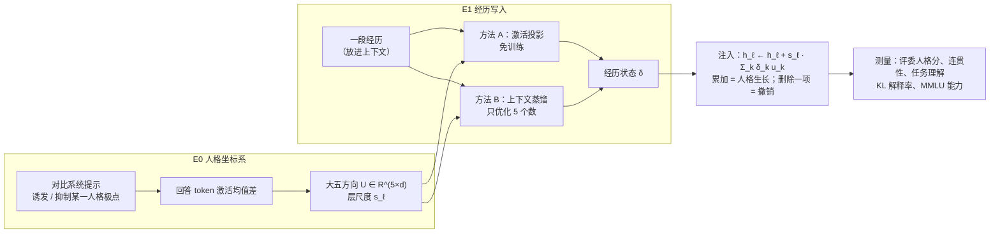
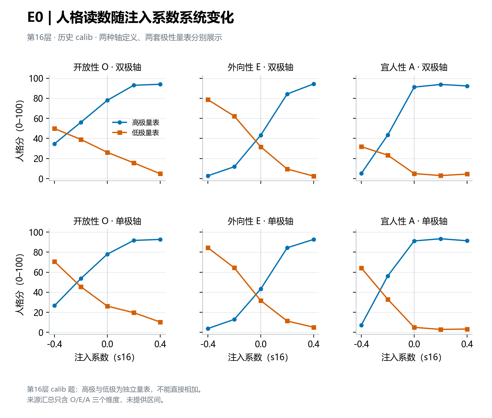
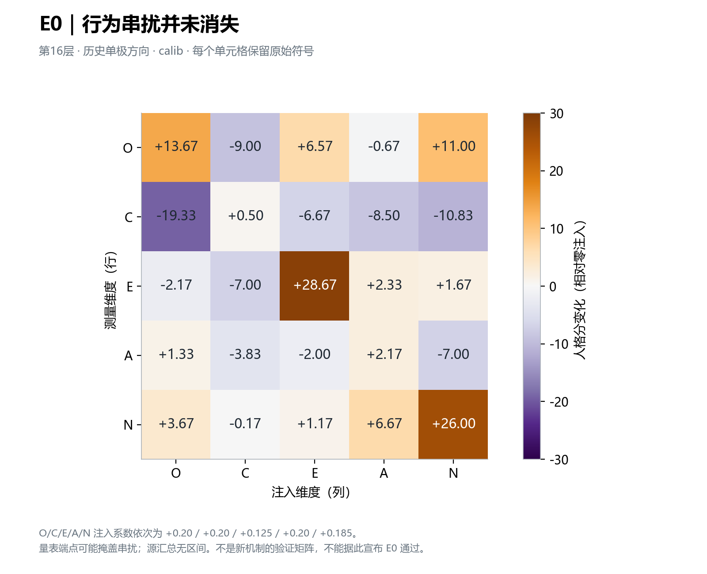
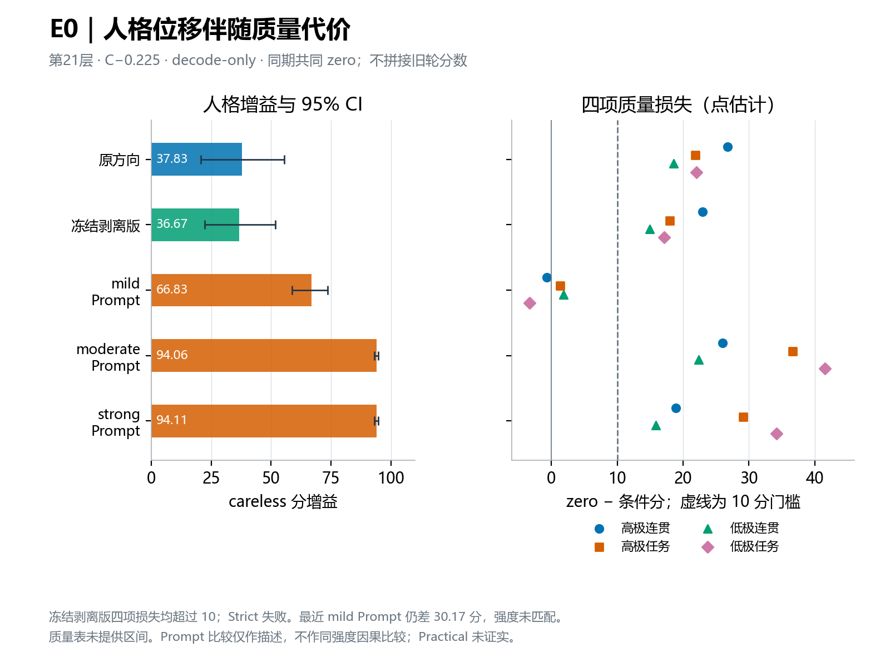
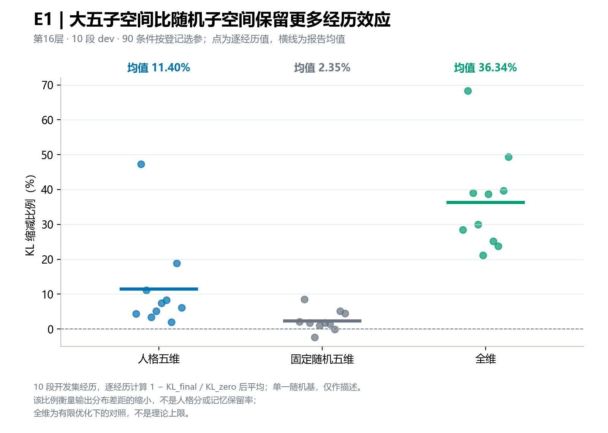
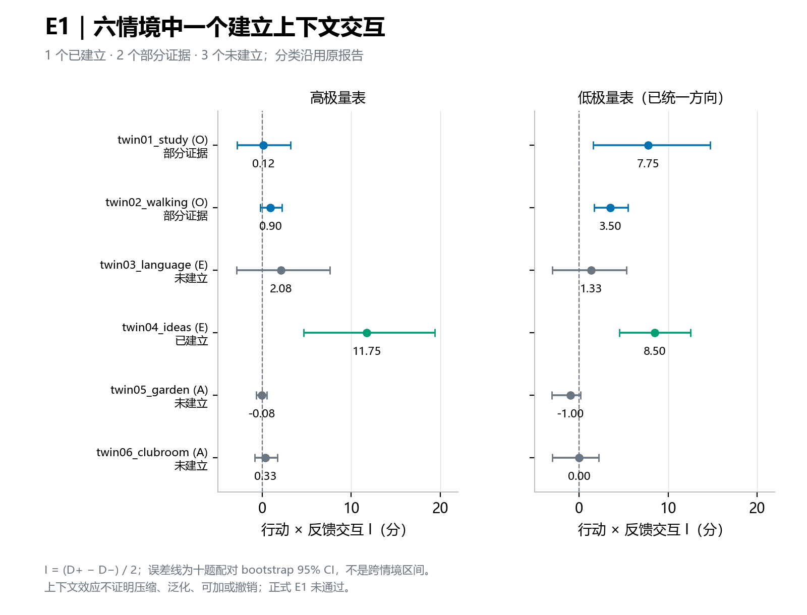
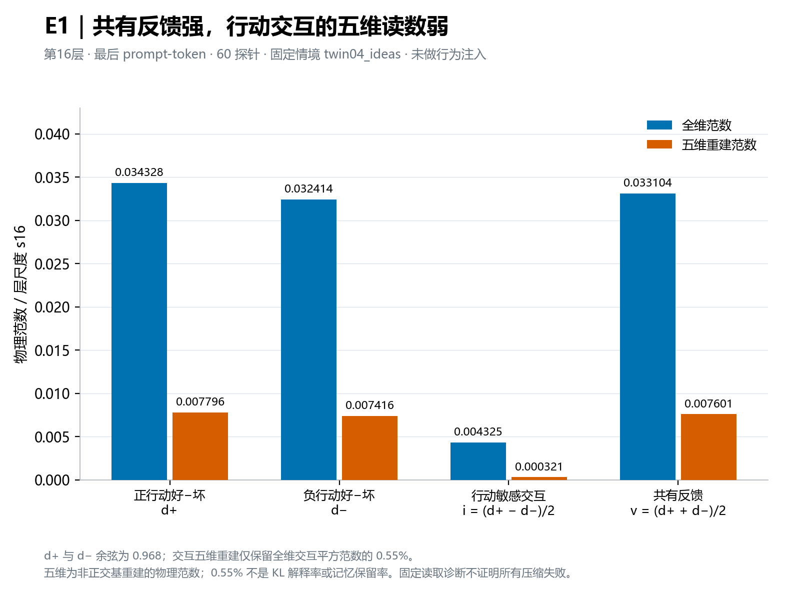
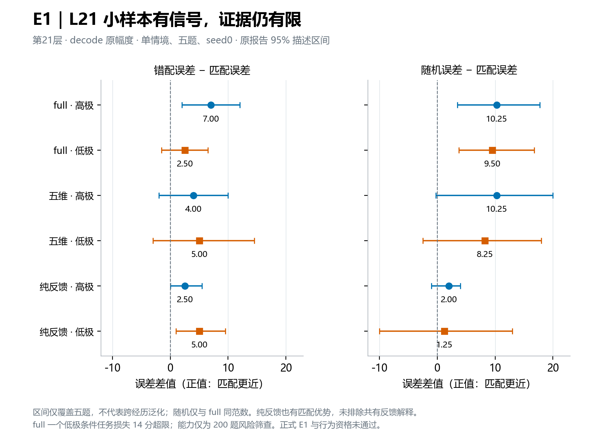

<div align="center">

# 鹿角记忆 · Antler Memory

**让大语言模型的人格由"经历"写入：冻结权重下的残差流激活状态**

*Writing experiences into the persona of a frozen LLM via residual-stream activation states*

[](requirements.txt)
[](requirements.txt)
[](https://huggingface.co/Qwen/Qwen3-4B-Instruct-2507)
[](tests/)
[](LICENSE)

王凌松 · 华东师范大学 软件工程 · [17721556010@163.com](mailto:17721556010@163.com)

</div>

---

## 简介

鹿角每年脱落、重新生长，每一圈都记录着这一年的经历。本项目想让大模型的人格也像鹿角一样：**由经历一段段长出来，每一段的影响都能单独查看、单独撤销。**

现有让大模型表现出稳定人格的方法主要有两类：系统提示容易被上下文冲淡；微调代价高，而且改了权重就撤不回来。近期工作（Persona Vectors、PERSONA）发现，大五人格特质在残差流中对应近似线性的方向，可以在推理时注入。但这些方法里的人格系数要么由人手设定，要么由模型根据当前上下文临时预测，**都不是由"经历"沉淀下来的**。

本项目研究：**一段经历对模型的影响，能否压缩成残差流中的一个低维状态，并且可以累加、可以撤销？** 模型权重始终冻结，所有干预都只是在某一层残差流上加一个向量，卸掉钩子模型即完全恢复原样。

**English summary.** Antler Memory asks whether the effect of an *experience* on a frozen LLM (Qwen3-4B-Instruct-2507) can be compressed into a low-dimensional, additive and removable residual-stream state, read out along Big-Five persona directions. We build a Big-Five coordinate system by activation steering (E0), write single experiences as state vectors by projection and by context distillation (E1), and test them with pre-registered, independently audited experiments. Our clearest finding so far is diagnostic: the difference between good and bad outcomes of an experience is encoded almost entirely along a shared valence-like "feedback" direction (cosine 0.968 across actions), while the action-specific signal retains only 0.55% of its squared norm in the five persona dimensions. This suggests a mechanistic account of why LLM personas change "in mean but not in shape", which is the planned focus of the thesis.

## 方法概览



- **人格坐标系（E0）**：沿用 Persona Vectors 的提取流程。对大五的 10 个极点，用诱发与抑制该特质的系统提示生成回答，由评委过滤后取回答 token 激活的均值差，得到每个维度的方向 u_k；以该层激活的平均范数 s_ℓ 为单位注入。
- **方法 A，激活投影**：比较"经历在上下文中"与"结构相同的中性记忆"时，最后一个 prompt token 的激活差，用对偶基读出五维坐标。
- **方法 B，上下文蒸馏**：以"经历在上下文中"的模型为老师、只注入 δ 的模型为学生，最小化逐 token KL，只优化 5 个数。
- **人格解释率**：ρ = (KL₀ − KL_δ) / KL₀，衡量一段经历对输出分布的影响中，有多大比例能用五维人格状态表达，并与同维度的随机子空间对照。
- **双胞胎经历**：同一情境、同一行动，只有结局相反（被夸奖 / 被嘲笑），用于区分"模型记住了具体经历"和"只记住了好坏情绪"。

形式化定义与全部设计细节见 [研究规格书](docs/RESEARCH_SPEC.md)。

## 研究问题与当前进展

| | 研究问题 | 状态 |
|---|---|---|
| RQ1 | 大五线性方向在单层注入下能把人格推多远？代价多大？ | 已完成一轮方法搜索：有效果，但质量或能力代价超过预设门槛，**未通过严格验收** |
| RQ2 | 一段经历对人格的影响，能否压缩成 5 个数？ | 开发集上有探索信号；**正式验证尚未完成** |
| RQ3 | 写入的状态能否组合、区分和撤销？ | 已完成双胞胎经历的上下文与状态诊断，发现关键瓶颈（见下文） |
| RQ4 | 长期累积时人格轨迹是否可控、稳定？ | 计划中 |
| RQ5 | 与 PERSONA-Flow 等方法相比如何？ | 计划中 |

本项目所有通过标准都在看到结果之前写定。下文如实报告未通过的部分。

## 主要发现

> 以下结果均来自开发阶段的固定批次实验，每项都有运行前登记、完整归档和独立复核；区间为 95% 置信区间。它们支持下文所述的具体结论，**不代表方法已经通过正式验证**。

### 1. 人格方向可以调节，但单层注入有质量代价

在第 21 层只在生成阶段注入，"尽责性"负方向能让 careless 人格分提高 **36.7 分 [22.4, 51.8]**，但连贯性和任务理解的四项损失均超过预设的 10 分门槛。另一个维度（神经质）的生成式能力下降 **6.1 个百分点**（906/1400 → 820/1400），超过 2 个百分点的门槛。作为对照，最温和的系统提示在本次测量中人格效果更大、质量代价更小（两者强度未能匹配，只作描述性比较）。因此本轮按事先约定停止 E0 搜索，不继续调参"刷"通过率。

<p align="center">
  
  
</p>
<p align="center">
  
</p>

详见 [E0 收尾报告](docs/E0_ROUND_CLOSEOUT_2026-10-04.md)。

### 2. 五维人格状态能解释一部分经历影响，明显多于随机子空间

在 10 段开发经历、90 个条件的优化诊断中，用大五子空间蒸馏得到的五维状态，平均解释经历对输出分布影响的 **11.40%**；同维度的随机子空间只有 **2.35%**，不受约束的全维向量为 **36.34%**。经历的影响里确实有一部分落在人格方向上，但大部分不在。

<p align="center">
  
</p>

详见 [E1 进展总览](docs/E1_PROGRESS_AND_ISSUES.md)、[KL pilot 结果](docs/E1_KL_PILOT_RESULTS_2026-10-04.md)。

### 3. "行动 × 结局"在上下文中的作用只在部分情境中成立

我们设计了 6 个情境 × 2 种行动 × 2 种结局共 24 段双胞胎经历，生成 2520 条回答，检验"同样的行动，结局不同，模型之后的人格表现是否不同"。结果是 1 个情境建立、2 个有部分证据、3 个未建立。这说明，即使经历就放在上下文里，模型对"行动的后果"的利用也不稳定。

<p align="center">
  
</p>

详见 [上下文闸门结果](docs/E1_TWIN_CONTEXT_GATE_RESULTS_2026-10-05.md) 和 [独立审计](docs/E1_TWIN_GATE_AUDIT_2026-10-05.md)。

### 4. 关键发现：经历主要被读成一个笼统的"好/坏"信号

在已建立效应的情境里，我们直接读取第 16 层的内部状态。"好结局减坏结局"的激活差，在两种相反的行动下几乎完全同向（**余弦 0.968**）。真正区分"做了什么"的交互分量，范数只有共同反馈分量的约 13%，投影到五维人格子空间后仅保留 **0.55%** 的平方范数。

换句话说，模型在内部主要记住的是"这次结果好不好"，而不是"我做了什么、因此应该怎样改变"。这为一个外部现象提供了可能的机制解释：已有研究（Do AI Personas Grow?，2026）在行为层面发现，大模型智能体经历人生事件后的人格变化"只模拟了人类人格变化的均值，而没有模拟出它的形状"。

<p align="center">
  
</p>

详见 [内部状态读取结果](docs/E1_TWIN_STATE_EXTRACTION_RESULTS_2026-10-05.md)。

### 5. 直接写入原幅度状态：有行为信号，但区分经历的证据较弱

把完整状态以原幅度写入第 21 层后，在高极量表上，匹配经历比结局相反的错配经历更接近对应的上下文行为，误差低 **7.0 分 [2.0, 12.0]**；同一量表的成对盲评中，相对随机向量的半胜率为 **72.5%**。但低极证据不稳，且"只携带共同反馈"的解释尚未排除。

<p align="center">
  
</p>

详见 [第 21 层小样本结果](docs/E1_L21_SMALL_PILOT_RESULTS_2026-10-05.md)。

## 研究方法上的做法

- **事先登记**：每个实验先写登记文件，固定数据、预算、通过标准和停止规则，再运行；修改规则必须写进规格书的变更记录。全部登记与结果见 [docs/](docs/README.md)。
- **有限停止**：达到预定停止条件就收尾，不追加样本、不在测试集上重选参数；失败结论原样保留。
- **防泄漏的数据切分**：提取集只用于提取方向和写入探针，评测集只用于测量；经历数据按情境家族划分 train / dev / test，测试会检查两者互不重叠。
- **可追溯的归档**：每次运行记录代码提交、配置、数据与产物的 SHA-256，并由独立脚本复算统计量。
- **多重测量**：评委人格分之外，同时测量连贯性、任务理解、生成截断和 MMLU 能力，避免把"答坏了"误当成"人格变了"。
- **工程质量**：1220 个 CPU 单元测试（用随机初始化的微型模型，无需下载权重），覆盖注入可拆卸性、梯度不泄漏到模型参数、各分析模块的统计正确性等。

## 局限

- 目前只在一个 4B 模型、少量开发经历和少数情境家族上实验，尚无冻结后的独立测试集结果。
- 人格分主要来自大模型评委，已做锚点与盲评核查，但仍不能替代大规模人工标注。
- 单层线性注入在较大幅度下会损伤质量；大五方向之间存在串扰。

## 下一步：毕业论文方向

以上发现把问题聚焦到一个可检验的假说上：**大模型在上下文中读到的"经历"，主要被编码为一个通用的情感效价（好/坏）方向，从而淹没了与具体事件相关的人格变化信号。**

计划在 7–8B 开源模型和已有的 BFI-Adapt 人生事件基准上：

1. 复现行为层面"人格变化有均值、无形状"的现象；
2. 把事件引起的激活差分解为"效价子空间投影 + 残差"，量化效价解释的方差比例；
3. 用回归检验行为层的人格变化由哪一部分预测；
4. 做因果干预：消融效价分量、只保留残差后再测，看方向是否更符合人类心理学的先验。

无论结果正负，都能回答"问题出在模型对事件的理解，还是出在读出方式"。

## 仓库结构

```
antler/
├── antler/          核心代码：注入与激活记录（core）、人格方向（traits）、测量与统计（eval）、经历写入（memory）
├── experiments/     每个实验一个入口脚本
├── tests/           CPU 单元测试（随机微型模型，无需下载）
├── configs/         正式实验与本地调试配置
├── data/            人格数据包与试验经历（第三方数据保留原许可）
├── docs/            研究规格书、实验登记与结果报告（导航见 docs/README.md）
├── figures/         本页图表
├── results/         图表所用的小型汇总数据
└── scripts/         数据准备、批量运行、结果抽取与绘图脚本
```

## 快速开始

```bash
python -m venv .venv && source .venv/bin/activate      # Windows: .venv\Scripts\activate
pip install torch --index-url https://download.pytorch.org/whl/cpu
pip install -r requirements.txt
pytest -q tests                                         # CPU 即可运行全部单元测试
python experiments/e0_layer_norms.py --config configs/debug.yaml   # 用 Qwen2.5-0.5B 冒烟测试
```

正式实验需要单张 24 GB 显卡和一个 OpenAI 兼容的评委接口。完整命令见 [运行指南](docs/USAGE.md)；图表可用 `python scripts/make_figures.py` 从 `results/` 重新生成。原始回答、评分与张量体积较大，不随仓库发布。

## 相关工作与数据

方法与数据建立在以下工作之上：Persona Vectors（Chen et al., 2025）、PERSONA（Feng et al., ICLR 2026）、PersonalityBench / NPTI（Deng et al., ICLR 2025）、TRAIT（Lee et al., NAACL 2025 Findings）、CAA（Rimsky et al., ACL 2024）、Representation Engineering（Zou et al., 2023）、上下文蒸馏（Askell et al., 2021；Snell et al., 2022）、互补学习系统理论（McClelland et al., 1995）及其在大模型上的扩展（Pan et al., 2026）、Do AI Personas Grow?（Wang et al., 2026）。完整的相关工作梳理与定位见 [研究规格书第 3 节](docs/RESEARCH_SPEC.md#3-相关工作与定位)。

## 引用

```bibtex
@misc{wang2026antler,
  title  = {Antler Memory: Writing Experiences into the Persona of a Frozen LLM
            via Residual-Stream Activation States},
  author = {Wang, Lingsong},
  year   = {2026},
  howpublished = {\url{https://github.com/969385278/antler}}
}
```

## 许可

代码与文档以 [MIT 许可](LICENSE) 发布。`data/kit/` 中的第三方数据保留各自的原始许可，见 [数据包说明](data/kit/README.md)。
